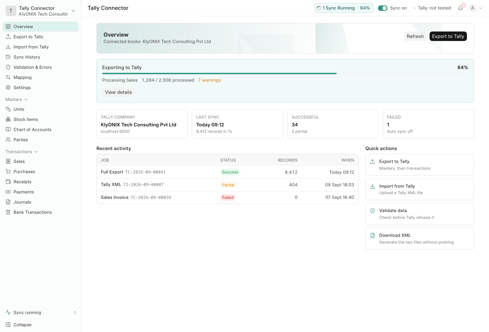
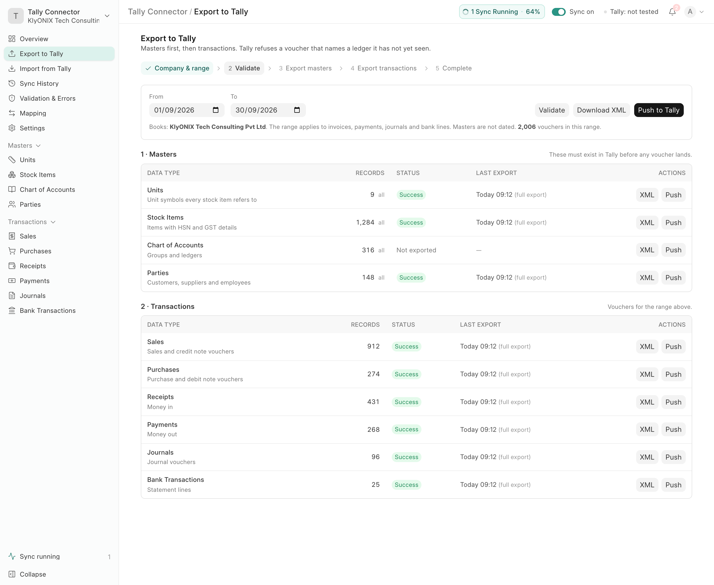
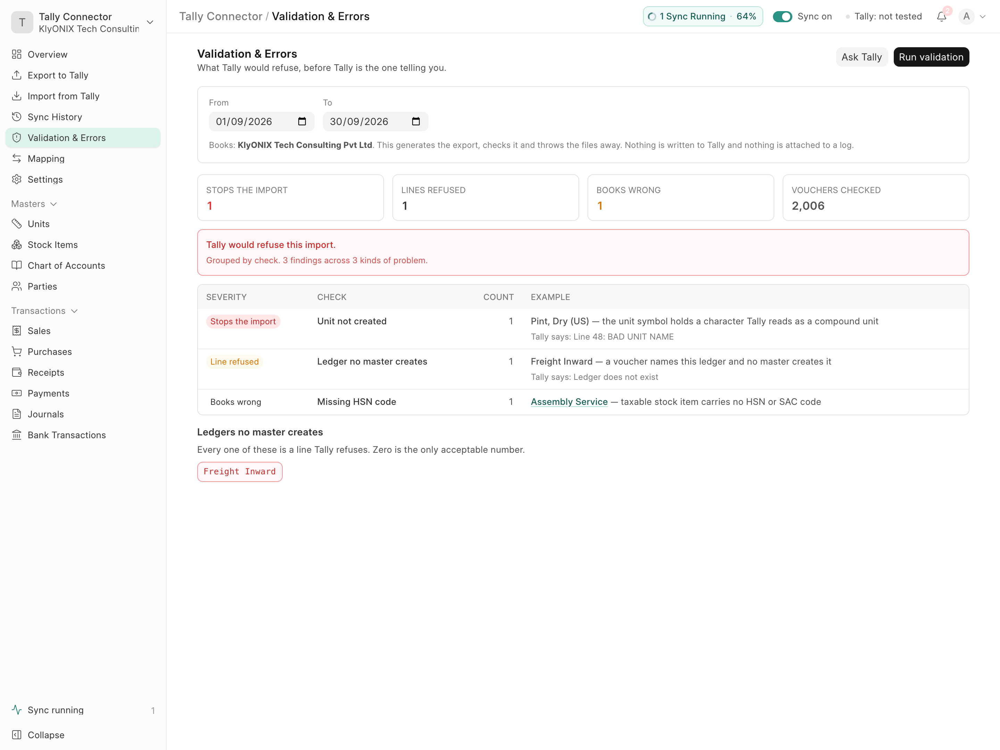
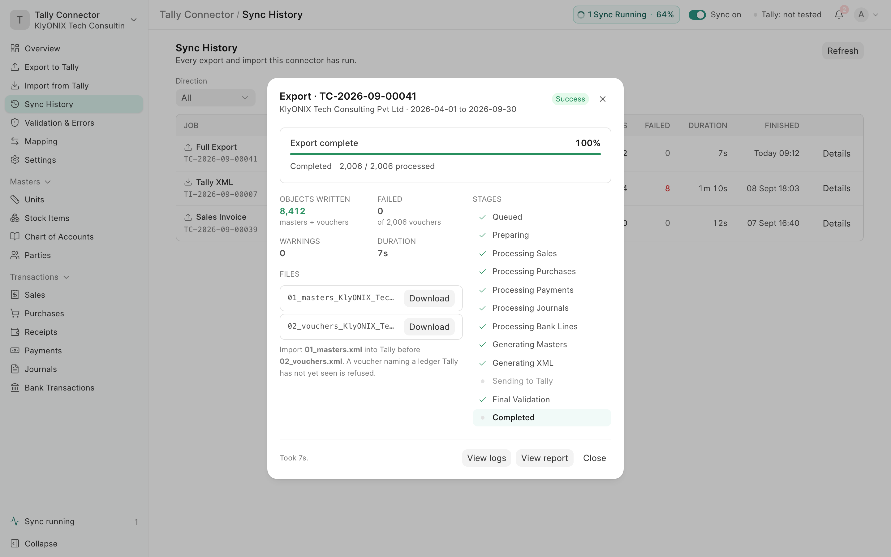
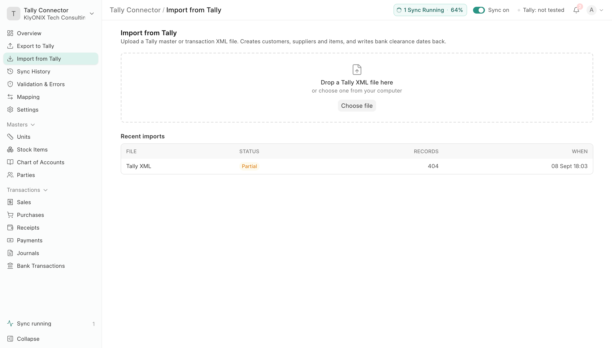
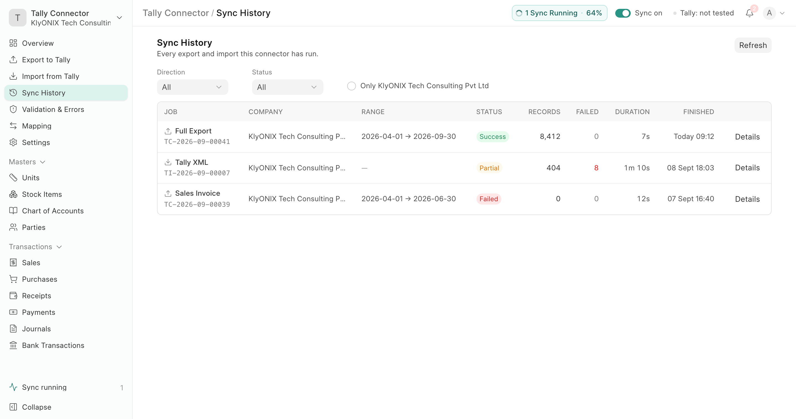
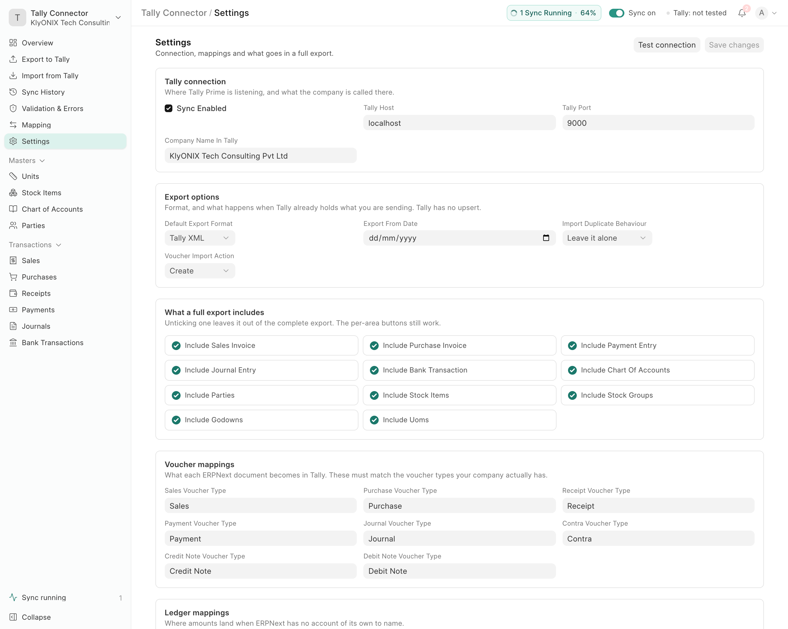

# Tally Connector

Send ERPNext accounting data to Tally Prime as XML, and bring Tally masters and
bank clearance dates back.

A Frappe app with its own dashboard. It reads the books, builds the two files
Tally imports, and checks them against Tally's rules **before** you find out from
Tally's event log - which aborts an import at the first line it cannot parse and
reports only that line.

> The company name in the screenshots is ours. **Every figure in them is
> invented** - the counts, dates, amounts and document numbers are a demo
> dataset, not anybody's books.



---

## Contents

- [Install](#install)
- [Set it up](#set-it-up)
- [Export to Tally](#export-to-tally)
- [Check it before Tally does](#check-it-before-tally-does)
- [Long exports run in the background](#long-exports-run-in-the-background)
- [Import from Tally](#import-from-tally)
- [Sync history](#sync-history)
- [Settings](#settings)
- [Who can do what](#who-can-do-what)
- [Things worth knowing](#things-worth-knowing)
- [Known limits](#known-limits)
- [Development](#development)

---

## Install

```bash
bench get-app https://github.com/klyonix/tally_connector
bench --site your-site.local install-app tally_connector
bench --site your-site.local migrate
```

Requires Frappe **v15 or v16** and ERPNext. `india_compliance` is optional - with
it, GST ledgers are classified from ERPNext's own GST account settings; without
it they are exported unclassified and the validator says so.

Then open **`/tally-connector`**, or press **Open Tally Connector** on the Tally
Connector workspace in the Desk.

**One thing to get right on a server:** exports above 2,000 vouchers are handed
to a background worker, so a worker must be running on the `long` queue. Without
one the job sits at *Queued* and never starts - the dashboard will say so rather
than pretend, but nothing will happen.

---

## Set it up

**Settings → Tally connection.** Three fields matter:

| Field | What it is |
|---|---|
| **Tally host / port** | Where Tally Prime's XML server is listening. Default `localhost:9000`. |
| **Company name in Tally** | The company name **exactly as Tally spells it**. This goes into every file's `SVCURRENTCOMPANY`, and it is what decides which company in Tally receives the data. |

Press **Test connection** - it answers in about five seconds either way, so a
Tally that is switched off tells you quickly.

If ERPNext is in the cloud and Tally is on an office LAN, a direct push will not
work. Use **Download XML** and import the files by hand; everything else works
the same.

---

## Export to Tally



The page is a map, not a wizard - most days you re-run one step rather than walk
all five.

1. **Company and range.** The company comes from the switcher at the top of the
   sidebar. The range applies to invoices, payments, journals and bank lines;
   **masters are not dated**, so a narrow range still exports the whole chart.
2. **Validate.** Generates the export, checks it, throws the files away. Writes
   nothing and touches nothing.
3. **Export masters.** Units, stock items, chart of accounts, parties.
4. **Export transactions.** The vouchers for the range.
5. **Complete.**

**Download XML** and **Download Excel** each give you two files:

```
01_masters.xml     import this into Tally first
02_vouchers.xml    then this
```

**Which format.** Both are written from the same export, so they cannot disagree
about what the books say. What differs is how Tally reads them.

| | |
|---|---|
| **Tally XML** | Gateway of Tally > Import > Vouchers. The only format **Push to Tally** can send, because the gateway takes XML. |
| **Excel** | Tally's own sample workbooks: *All Accounting Masters* (Ledger, Group, Cost Category, Cost Centre) and *Accounting Vouchers*. Every column header comes from the Read Me sheet of those templates, and the export invents none. Sign is a word here: the amount is the magnitude, and `Dr` or `Cr` sits in the next column. A voucher is a run of rows, the first carrying its own fields and the rest leaving them blank. |

The Excel workbooks carry accounting masters and accounting vouchers. Units,
stock groups and stock items are not in Tally's accounting templates, so an item
a voucher names has to already exist in the company; the XML export creates
them.

**The order is not a preference.** Tally refuses a voucher that names a ledger,
unit or stock item it has not yet seen, and it stops the whole file at the first
line it cannot read. Masters first is the difference between one refused line and
a refused import.

**Push to Tally** does the same thing over the network, masters first, and stops
if the masters fail rather than sending vouchers into a company that has no
ledgers for them.

Each row has its own **XML** and **Push** buttons if you only need one area.

---

## Check it before Tally does



**Validation & Errors** generates the export, reads it back and holds it against
Tally's rules. Nothing is written to Tally and nothing is attached to a log.

Findings come in three severities, grouped by check - 465 party lines missing a
bill reference is one problem to fix, not 465 rows to read:

| Severity | Means |
|---|---|
| **Stops the import** | Tally aborts at this line and everything after it is lost. |
| **Line refused** | Tally accepts the file and refuses this line. |
| **Books wrong** | It imports cleanly and the books are wrong - a GST ledger outside *Duties & Taxes* is missing from GSTR-1, and nothing anywhere reports it. |

Where the subject is an ERPNext document, it is a link straight to the record.

**Ask Tally** is separate and optional: it asks the destination company what
voucher types it has and when its books begin. The two checks that need it are
skipped rather than guessed when Tally is not switched on.

A full export also validates itself. If the file it just wrote would be refused,
the job finishes as **Partial** with the reason on it - rather than reporting
success and letting you discover it in Tally's event log an hour later.

---

## Long exports run in the background

Above 2,000 vouchers the work goes to a worker and the page stops waiting.



The progress is real. Each voucher the export builds ticks the count, and the
denominator is the number of rows the export will actually read. A stage with
nothing to count says so and leaves the number where it was, rather than easing a
bar over work with no rows in it.

- The header shows **`1 Sync Running · 64%`** on every page. Click it to reopen
  the details.
- Leaving the page, reloading, or opening the app in another tab does not lose
  the job - the log is the record and the browser reads it back.
- A stage that never ran is **not** ticked. A download-only export shows
  *Sending to Tally* as unreached, because it was.
- A job that stops reporting for ten minutes is shown as **stalled**, not
  running, and can be cancelled. That is what a worker that died looks like.

When it finishes you get the successful and failed counts, warnings, duration and
both files.

---

## Import from Tally



Drop a Tally XML file, or choose one.

1. **Validate file** - does it parse, and what is in it? Answered before
   anything is written, because the alternative is finding out after half the
   customers in it have been created.
2. **Start import** - runs in the background with the same progress.

It creates customers, suppliers, items and UOMs, and writes bank clearance dates
back onto submitted Payment and Journal Entries.

---

## Sync history



Every export and import, in one list, newest first - company, range, status,
record counts, failures, duration. **Details** reopens the full panel with the
stages and the files.

Nothing is deleted. A cancelled job keeps saying it was cancelled and by whom.

---

## Settings



- **Tally connection**: host, port, the company name as Tally spells it, and the
  master **Sync** switch.
- **Export options**: format, and what happens when Tally already holds what you
  are sending.
- **What a full export includes**: untick an area to leave it out of the
  complete export. The per-area buttons still work.
- **Voucher mappings**: what each ERPNext document becomes in Tally. These must
  match voucher types your company actually has.
- **Ledger mappings**: where amounts land when ERPNext names no account.
- **Scheduled sync**: automatic pushes, and which side wins on bank
  reconciliation.

**The sync switch is at the top of every page.** Off, the server refuses every
export and import - a scheduled run and a stray API call hit the same rule the
buttons do. It is there so whoever is watching a sync go wrong can stop it
without finding a settings page.

---

## Who can do what

| | Roles |
|---|---|
| Run an export, download XML, view history | System Manager, Accounts Manager, **Accounts User** |
| Change settings, import from Tally | System Manager, Accounts Manager |

Running an export is clerical. Changing which ledger the books land in, and
writing into the ledger from a file, are not.

Every endpoint checks the role, and the company is checked against the caller's
own permissions rather than defaulted from whatever the database returns first.

---

## Things worth knowing

These are Tally's rules, learned the hard way. They explain most of what the app
does that looks fussy.

**Tally has no upsert.** Importing the same file twice with `Create` adds a
second voucher; `Alter` fails on a voucher Tally has never seen. Neither is right
for both, so it is a setting somebody chooses. The voucher number is the ERPNext
document name, which is what an `Alter` addresses a voucher by and what ties a
Tally voucher back to its source.

**A masters file is finished only when Tally.imp says `Errors: 0`.** Tally stops
a masters file at the first line it refuses and reports `Created: 17` for the
records before it, which reads like success. Every voucher after that fails on
a ledger that was never created, and nothing on the voucher side is wrong.
Import masters, read the summary, and only then import vouchers.

**Tally identifies a stock item by its name.** Two ERPNext items sharing an
`item_name` would be one item in Tally holding both their stock. Where that
happens, both fall back to their **item code**, which is the only thing ERPNext
holds that tells them apart.

**A Journal excludes cash and bank ledgers** unless *Allow Cash Accounts in
Journals* is on. So money moving between cash and bank is a **Contra**, money in
is a **Receipt**, money out is a **Payment**, and only what touches neither is a
Journal.

**`/` is Tally's compound-unit separator.** A UOM called `Meter/Second` is read
as a compound unit and refused, taking the file with it. Unit symbols are
sanitised, and the same function names the unit on the master, on the stock item
and in every quantity - so the three cannot disagree.

**GST is read from ERPNext's own GST accounts**, placed under *Duties & Taxes*
with a duty head. That is the only place Tally reads them from when it builds a
return; a GST ledger anywhere else imports perfectly and is missing from GSTR-1.

**Rounding follows ERPNext.** Where rounding is on, the party is posted the
*rounded* total and the difference goes to Round Off - the same entry ERPNext
made, so a receipt clears the bill exactly.

---

## Known limits

- **Expense Claims are not exported.** An employee's balance in Tally will not
  match ERPNext where expense claims exist.
- **TDS is booked net.** ERPNext credits the supplier gross and debits the
  deduction back on the same account; this posts the net once. Same ledger, same
  net, same outstanding - a presentation difference, not an accounting one.
- **The whole XML is built in memory** before it is written. About 18 MB at
  10,000 vouchers. Fine at any realistic size; it is not a streaming writer.
- **Cancelled documents are never exported**, and no submitted document is
  silently dropped - both are asserted against ERPNext's own general ledger.

---

## Development

```bash
# tests: 241 integration + 72 offline
bench --site your-site.local run-tests --app tally_connector

# the offline half needs no site at all
python -m unittest tally_connector.tests.test_render \
                   tally_connector.tests.test_validate \
                   tally_connector.tests.test_reimport \
                   tally_connector.tests.test_excel

# golden files: the rendered XML of 12 scenarios, byte for byte
python -m tally_connector.tally.golden --check
python -m tally_connector.tally.golden --write   # after a deliberate change

# the dashboard
cd frontend && yarn && yarn dev     # or yarn build
```

The layered part is the point:

```
                                   ┌──▶ render ──▶ XML
ERPNext ──▶ extract ──▶ model ──────┼──▶ excel  ──▶ XLSX
                          │         │
                          └────▶ validate ──▶ report
```

`tally/extract.py` is the only module that imports `frappe`. Everything
downstream - the model, the validator, the renderer - is pure, so a scenario runs
against a JSON fixture in milliseconds with no site and no Tally. `tally/read.py`
reads XML back into the model, which is what lets the validator check a file that
has already been written.

Tally-specific facts discovered along the way are recorded in
`tally/render.py::ASSUMPTIONS` rather than left for the next person to rediscover.

---

[AGPL-3.0](LICENSE) · [KlyONIX Tech](https://klyonix.com)
